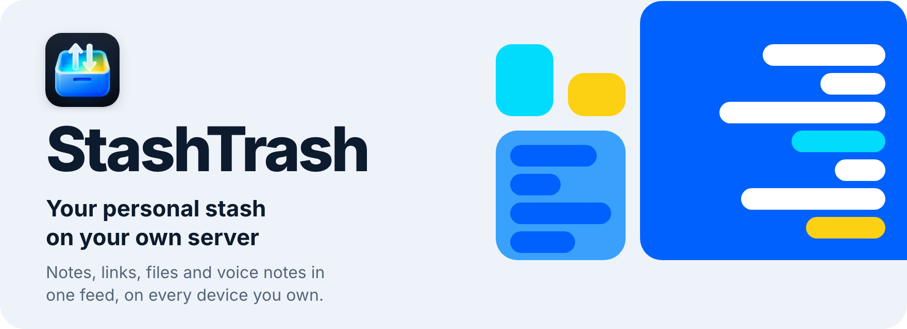
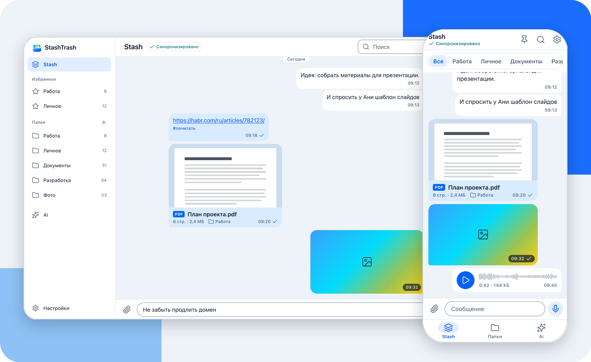
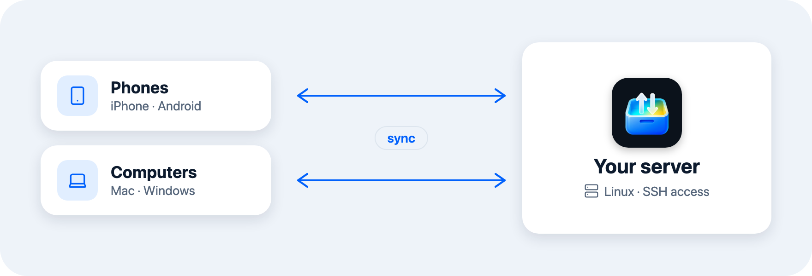
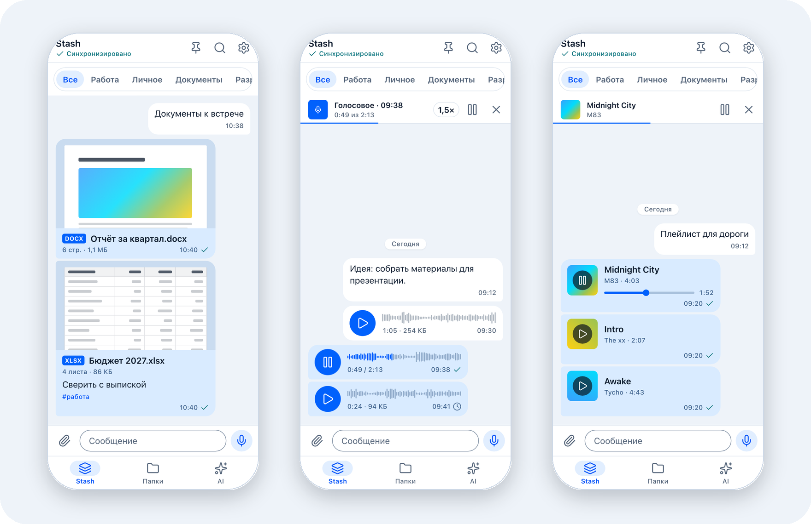
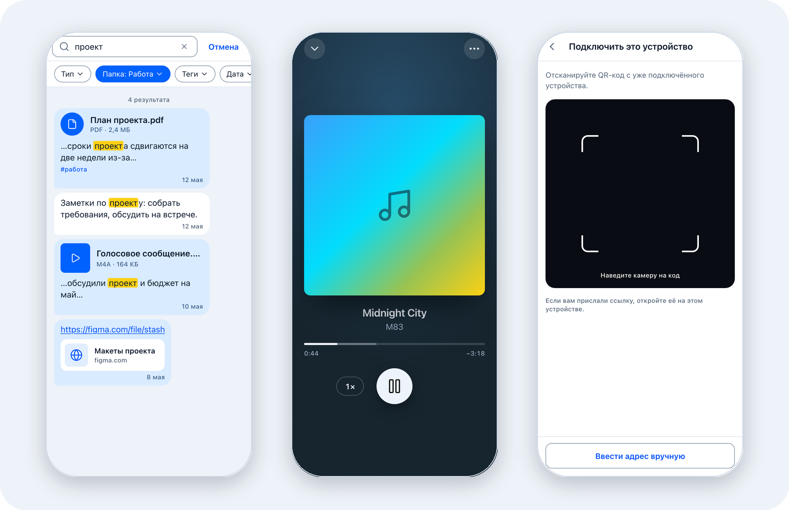
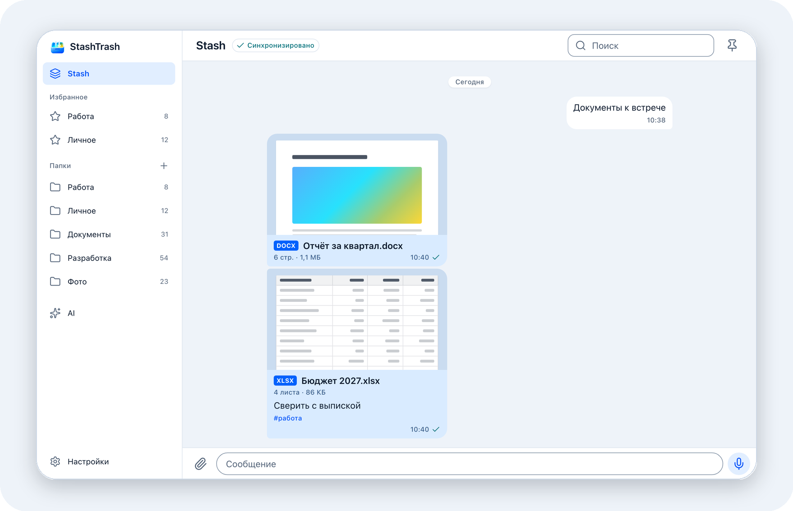
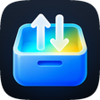

<p align="center">
  <b>English</b> · <a href="README.ru.md">Русский</a>
</p>

<p align="center">
  <picture>
    <source media="(prefers-color-scheme: dark)" srcset=".github/readme/hero-en-dark.png">
    
  </picture>
</p>

<p align="center">
  <a href="https://github.com/Salesao/stashtrash/releases/latest/download/StashTrash-android-arm64-v8a.apk"></a>
  <a href="https://github.com/Salesao/stashtrash/releases/latest/download/StashTrash-macos.dmg"></a>
  <a href="https://github.com/Salesao/stashtrash/releases/latest/download/StashTrash-windows-x64.zip"></a>
  <a href="https://github.com/Salesao/stashtrash/releases/latest/download/StashTrash-linux-x64.tar.gz"></a>
  <picture><source media="(prefers-color-scheme: dark)" srcset=".github/readme/button-ios-soon-en-dark.png"></picture>
</p>

<p align="center">
  <a href="https://github.com/Salesao/stashtrash/releases/latest"></a>
  <a href="https://github.com/Salesao/stashtrash/releases"></a>
</p>

<p align="center">
  <picture>
    <source media="(prefers-color-scheme: dark)" srcset=".github/readme/showcase-dark.png">
    
  </picture>
</p>

## What it is

StashTrash is the "Saved Messages" chat from your messenger, running on your own server. Send yourself a note, a link, a photo, a document, a video, a song or a voice note, and it shows up on every device you own: your phone, your laptop, your work computer.

Your files and the database live on your server. You don't have to set it up by hand: the app connects to it over SSH and installs everything itself.

## Why

- **Your data stays with you.** It's your server, so the storage rules are yours. The only limit is your server's disk.
- **One place for everything you don't want to lose.** No more texting yourself in a messenger, keeping notes somewhere else, running a cloud drive and emailing files to yourself.
- **Phone to computer in one move.** Drag a file into the window, paste it, or use the paperclip.
- **Send now, sort later.** Sending asks for nothing. Folders and tags can be added afterwards.

## Features

<table>
  <tr>
    <td width="50%" valign="top"><b>One feed for everything</b><br>Notes, links, photos, videos, documents, music and voice notes are messages in one feed, like in a messenger.</td>
    <td width="50%" valign="top"><b>Synced across devices</b><br>What you send from one device shows up on the others. The sync status is always in sight.</td>
  </tr>
  <tr>
    <td valign="top"><b>File previews</b><br>PDF, Word, Excel and presentations show their first page in the feed. Photos and videos are grouped into albums.</td>
    <td valign="top"><b>Built-in viewers</b><br>Photos, videos, PDFs and a music player open right in the app.</td>
  </tr>
  <tr>
    <td valign="top"><b>Voice notes, Telegram-style</b><br>Hold the mic, or swipe up to record hands-free. Listen before you send.</td>
    <td valign="top"><b>Folders, tags and pins</b><br>Sort messages whenever you like. It never gets in the way of sending.</td>
  </tr>
  <tr>
    <td valign="top"><b>Search</b><br>By text, type, folder, tags and date, including inside documents and voice note transcripts.</td>
    <td valign="top"><b>New device, no SSH</b><br>Connect it with a QR code, a link or a six-digit code from a device that's already connected.</td>
  </tr>
  <tr>
    <td valign="top"><b>Server setup from the app</b><br>Enter your server's address and a password or SSH key. The app shows every install step, and the log if something goes wrong.</td>
    <td valign="top"><b>At home on every platform</b><br>Android, macOS, Windows and Linux today, iOS soon. Light and dark themes.</td>
  </tr>
</table>

## How it works

<p align="center">
  <picture>
    <source media="(prefers-color-scheme: dark)" srcset=".github/readme/how-en-dark.png">
    
  </picture>
</p>

1. **Install the app** on a computer or a phone.
2. **Connect your server.** Enter the address, port and user name, then a password or an SSH key. The app sets everything up and opens your feed.
3. **Add your other devices.** Open an invite on a device that's already connected. The new one joins with a QR code, a link or a six-digit code, with no SSH needed.

You need a Linux server with SSH access.
<!-- TODO: list supported distributions and minimum RAM and disk -->

## Download

| Platform | File | Install |
|---|---|---|
| Android (most phones) | [`StashTrash-android-arm64-v8a.apk`](https://github.com/Salesao/stashtrash/releases/latest/download/StashTrash-android-arm64-v8a.apk) | When Android asks, allow installs from this source. |
| Android (older 32-bit phones) | [`StashTrash-android-armeabi-v7a.apk`](https://github.com/Salesao/stashtrash/releases/latest/download/StashTrash-android-armeabi-v7a.apk) | The same steps. Pick this file if the arm64-v8a one won't install. |
| macOS | [`StashTrash-macos.dmg`](https://github.com/Salesao/stashtrash/releases/latest/download/StashTrash-macos.dmg) | Open the image and drag StashTrash to Applications. Works on Apple Silicon and Intel Macs. |
| Windows (64-bit) | [`StashTrash-windows-x64.zip`](https://github.com/Salesao/stashtrash/releases/latest/download/StashTrash-windows-x64.zip) | Unzip the archive and run `stash_trash.exe`. The first launch may show a Windows warning, see below. |
| Linux (64-bit) | [`StashTrash-linux-x64.tar.gz`](https://github.com/Salesao/stashtrash/releases/latest/download/StashTrash-linux-x64.tar.gz) | Unpack the archive into a folder and run `stash_trash`. The commands are below. |
| iOS | Soon | — |

Every version and its changelog is on the [Releases](https://github.com/Salesao/stashtrash/releases) page.

<details>
<summary><b>macOS won't open the app</b></summary>
<br>
Open System Settings → Privacy & Security. Near the bottom, next to the message about StashTrash, click "Open Anyway". You only need to do this once.
</details>

<details>
<summary><b>Windows says "Windows protected your PC"</b></summary>
<br>
The app isn't signed with a paid certificate yet, so Windows is cautious about it. Click "More info", then "Run anyway". You only need to do this once.
</details>

<details>
<summary><b>Windows says VCRUNTIME140.dll or MSVCP140.dll is missing</b></summary>
<br>
Install the <a href="https://aka.ms/vs/17/release/vc_redist.x64.exe">Microsoft Visual C++ Redistributable (x64)</a> and start the app again.
</details>

<details>
<summary><b>How to install and start on Linux</b></summary>
<br>

```sh
mkdir StashTrash
tar -xzf StashTrash-linux-x64.tar.gz -C StashTrash
./StashTrash/stash_trash
```

The build is made on Ubuntu 22.04 and needs glibc 2.34 or newer (Ubuntu 22.04, Debian 12, Fedora 35 and newer). It also needs GTK 3, GStreamer and libsecret. On Debian and Ubuntu:

```sh
sudo apt install libgtk-3-0 libgstreamer1.0-0 libgstreamer-plugins-base1.0-0 libsecret-1-0
```

There is no ARM build for Linux yet.
</details>

## Screenshots

Documents, voice notes and music:

<p align="center">
  <picture>
    <source media="(prefers-color-scheme: dark)" srcset=".github/readme/phones-1-dark.png">
    
  </picture>
</p>

Search, the player and connecting a new device:

<p align="center">
  <picture>
    <source media="(prefers-color-scheme: dark)" srcset=".github/readme/phones-2-dark.png">
    
  </picture>
</p>

On a computer:

<p align="center">
  <picture>
    <source media="(prefers-color-scheme: dark)" srcset=".github/readme/desktop-dark.png">
    
  </picture>
</p>

> The screenshots show the Russian interface. The app also has an English one: by default it follows the system language, and you can change it in Settings → Language.

## FAQ

<details>
<summary><b>Where are my files stored?</b></summary>
<br>
On your server: both the files and the database.
</details>

<details>
<summary><b>Do I need a separate server for each device?</b></summary>
<br>
No. You run one server, and all your devices connect to it.
</details>

<details>
<summary><b>Can I use it without a computer?</b></summary>
<br>
Yes. You can set up the server from your phone too: enter its address and a password or key right in the app.
</details>

<details>
<summary><b>What about iOS?</b></summary>
<br>
Not yet. The build is still to come. When it's ready, it will appear in the table above and on the Releases page.
</details>

<details>
<summary><b>What's the "AI" tab?</b></summary>
<br>
It's a section still in the works. The tab is already in place and will come to life in a future version.
</details>

<details>
<summary><b>Found a bug or have an idea</b></summary>
<br>
Open an <a href="https://github.com/Salesao/stashtrash/issues">issue</a>. Mention your platform, the app version and what happened. If the server install failed, attach the log from Settings → Diagnostics.
</details>

## License

The app's source code is closed. This repository hosts the builds and the changelog.

© 2026 Salesao. All rights reserved.

<br>

<p align="center">
  
  <br>
  <sub>StashTrash — your personal stash on your own server</sub>
</p>
