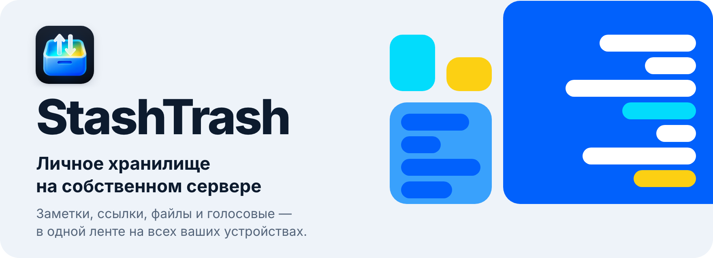
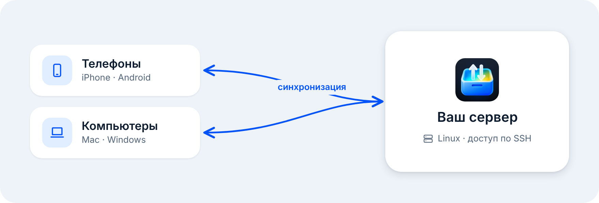

  <a href="README.md">English</a> · <b>Русский</b>

  <picture>
    <source media="(prefers-color-scheme: dark)" srcset=".github/readme/hero-ru-dark.png">
    
  </picture>

  
  
  <picture><source media="(prefers-color-scheme: dark)" srcset=".github/readme/button-windows-soon-ru-dark.png"></picture>
  <picture><source media="(prefers-color-scheme: dark)" srcset=".github/readme/button-ios-soon-ru-dark.png"></picture>

  
  

  <picture>
    <source media="(prefers-color-scheme: dark)" srcset=".github/readme/showcase-dark.png">
    
  </picture>

## Что это

StashTrash — это «Избранное» из мессенджера, только на вашем собственном сервере. Вы отправляете себе заметку, ссылку, фото, документ, видео, музыку или голосовое, и оно появляется на всех ваших устройствах: на телефоне, ноутбуке и рабочем компьютере.

Файлы и база лежат на вашем сервере. Настраивать его вручную не нужно: приложение подключается к нему по SSH и ставит всё само.

## Зачем

- **Ваши данные — у вас.** Сервер ваш, и правила хранения тоже ваши. Объём ограничен только диском сервера.
- **Одно место для всего, что жалко потерять.** Больше не нужно писать самому себе в мессенджере, вести заметки отдельно, держать облачный диск и пересылать файлы себе на почту.
- **Перекинуть файл с телефона на компьютер — одно действие.** Перетащите файл в окно, вставьте из буфера или нажмите «+».
- **Отправить сейчас, разобрать потом.** При отправке ничего не нужно выбирать. Папку и теги можно назначить позже.

## Возможности

<table>
  <tr>
    <td width="50%" valign="top"><b>Одна лента на всё</b> Заметки, ссылки, фото, видео, документы, музыка и голосовые — сообщения одной ленты, как в мессенджере.</td>
    <td width="50%" valign="top"><b>Синхронизация на всех устройствах</b> Отправленное с одного устройства появляется на остальных. Статус синхронизации всегда на виду.</td>
  </tr>
  <tr>
    <td valign="top"><b>Превью файлов</b> У PDF, Word, Excel и презентаций в ленте видна первая страница. Фото и видео собираются в альбомы.</td>
    <td valign="top"><b>Встроенный просмотр</b> Фото, видео, PDF и плеер для музыки открываются прямо в приложении.</td>
  </tr>
  <tr>
    <td valign="top"><b>Голосовые как в Telegram</b> Удерживайте микрофон или смахните вверх, чтобы записывать без рук. Перед отправкой запись можно прослушать.</td>
    <td valign="top"><b>Папки, теги и закреплённые</b> Разложить сообщения можно потом. На отправку это не влияет.</td>
  </tr>
  <tr>
    <td valign="top"><b>Поиск</b> По тексту, типу, папке, тегам и дате. Ищет и внутри документов, и в расшифровках голосовых.</td>
    <td valign="top"><b>Новое устройство без SSH</b> Подключается по QR-коду, ссылке или коду из шести цифр с устройства, которое уже подключено.</td>
  </tr>
  <tr>
    <td valign="top"><b>Сервер ставится из приложения</b> Укажите адрес сервера, пароль или SSH-ключ. Приложение покажет каждый этап установки, а если что-то пойдёт не так — журнал.</td>
    <td valign="top"><b>Свой вид на каждой платформе</b> macOS и Android уже сейчас, Windows и iOS скоро. Светлая и тёмная тема.</td>
  </tr>
</table>

## Как это работает

  <picture>
    <source media="(prefers-color-scheme: dark)" srcset=".github/readme/how-ru-dark.png">
    
  </picture>

1. **Установите приложение** на компьютер или телефон.
2. **Подключите сервер.** Укажите адрес, порт и имя пользователя, затем пароль или SSH-ключ. Приложение всё настроит само и сразу откроет ленту.
3. **Добавьте остальные устройства.** Откройте приглашение на уже подключённом устройстве. Новое подключается по QR-коду, ссылке или коду из шести цифр, SSH ему не нужен.

Нужен сервер на Linux с доступом по SSH.
<!-- TODO: уточнить поддерживаемые дистрибутивы и минимум памяти и диска -->

## Скачать

| Платформа | Файл | Установка |
|---|---|---|
| Android (большинство телефонов) | [`StashTrash-android-arm64-v8a.apk`](https://github.com/Salesao/stashtrash/releases/latest/download/StashTrash-android-arm64-v8a.apk) | Когда Android спросит, разрешите установку из этого источника. |
| Android (старые 32-битные телефоны) | [`StashTrash-android-armeabi-v7a.apk`](https://github.com/Salesao/stashtrash/releases/latest/download/StashTrash-android-armeabi-v7a.apk) | Те же шаги. Выбирайте этот файл, если arm64-v8a не устанавливается. |
| macOS | [`StashTrash-macos.dmg`](https://github.com/Salesao/stashtrash/releases/latest/download/StashTrash-macos.dmg) | Откройте образ и перетащите StashTrash в «Программы». Подходит для Mac на Apple Silicon и Intel. |
| Windows | Скоро | — |
| iOS | Скоро | — |

Все версии и список изменений — в [Releases](https://github.com/Salesao/stashtrash/releases).

<!-- TODO: вернуть заметку про Windows SmartScreen, когда сборка для Windows будет опубликована -->

<b>macOS не даёт открыть приложение</b>

 
Откройте «Системные настройки» → «Конфиденциальность и безопасность». Внизу, рядом с сообщением о StashTrash, нажмите «Всё равно открыть». Это нужно сделать один раз.

## Скриншоты

Документы, голосовые и музыка:

  <picture>
    <source media="(prefers-color-scheme: dark)" srcset=".github/readme/phones-1-dark.png">
    
  </picture>

Поиск, плеер и подключение нового устройства:

  <picture>
    <source media="(prefers-color-scheme: dark)" srcset=".github/readme/phones-2-dark.png">
    
  </picture>

На компьютере:

  <picture>
    <source media="(prefers-color-scheme: dark)" srcset=".github/readme/desktop-dark.png">
    
  </picture>

## Вопросы

<b>Где хранятся мои файлы?</b>

 
На вашем сервере: там лежат и файлы, и база.

<b>Нужен ли отдельный сервер для каждого устройства?</b>

 
Нет. Сервер один, к нему подключаются все ваши устройства.

<b>Можно ли обойтись без компьютера?</b>

 
Да. Сервер настраивается и с телефона: адрес сервера и пароль или ключ вводятся прямо в приложении.

<b>А как же Windows и iOS?</b>

 
Пока нет: сборки для них ещё впереди. Когда они будут готовы, появятся в таблице выше и на странице Releases.

<b>Что за вкладка «AI»?</b>

 
Этот раздел ещё в разработке. Вкладка уже стоит на своём месте и заработает в одной из следующих версий.

<b>Нашёл ошибку или есть идея</b>

 
Напишите в <a href="https://github.com/Salesao/stashtrash/issues">Issues</a>. Укажите платформу, версию приложения и что произошло. Если ошибка при установке сервера, приложите журнал из «Настройки» → «Диагностика».

## Лицензия

Код приложения закрыт. В этом репозитории публикуются сборки и список изменений.

© 2026 Salesao. Все права защищены.

 

  
   
  StashTrash — личное хранилище на собственном сервере

